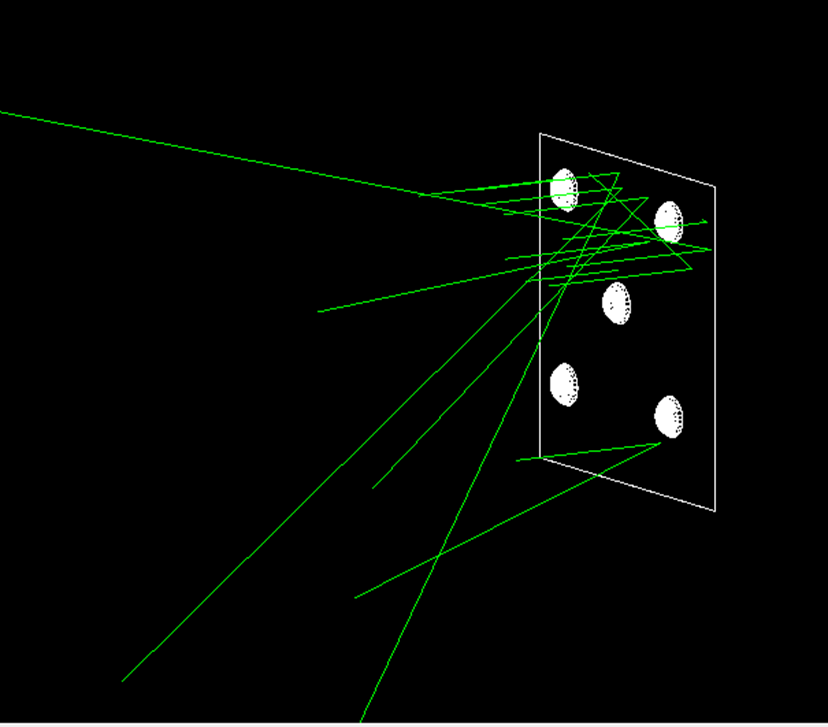
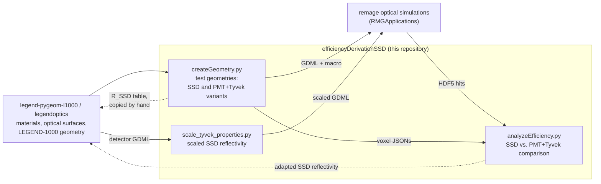

# efficiencyDerivationSSD

Validation of the sensitive surface detector (SSD) used in the simulations of the LEGEND-1000 neutron
tagger, the photomultiplier system of the water tank. The repository builds simplified Geant4
geometries in which a continuous SSD surface and an explicit layout of PMTs on Tyvek foil can be
simulated in the same setup, and compares the optical hits of the two simulations. The comparison is
used to adapt the reflectivity of the SSD.

This repository is part of my master's thesis *"Optimisation of the LEGEND-1000 Neutron Tagger Using a
Surrogate Monte Carlo Simulation"* (Eberhard Karls Universität Tübingen).

## Background

In the LEGEND-1000 simulations, the inner surfaces of the water tank are not instrumented with
individual PMTs. Instead they form one SSD, a single optical surface whose properties are an overlay
of those of the PMTs and of the reflective Tyvek foil that lines the rest of the tank. The SSD
records photons over its whole surface, so a PMT layout can be chosen afterwards on the voxelised
surface (see [simPostProcessing](https://github.com/UniThommi/simPostProcessing#background) and
[voxelSelection](https://github.com/UniThommi/voxelSelection)).

The SSD reflectivity is the area-weighted mixture of PMT cathode and Tyvek:

```
R_SSD(λ) = S · R_cathode + (1 − S) · R_Tyvek(λ),      S = A_PMT / A_total = N_PMT · π r_c² / A_total
```

with the effective cathode radius r<sub>c</sub> = 110 mm, a wavelength-independent cathode
reflectivity R<sub>cathode</sub> = 0.0287 and the Tyvek reflectivity R<sub>Tyvek</sub>(λ), which
rises from 0.80 at 250 nm to 0.96 from 400 nm upwards.

This repository tests how well this superposition describes a discrete PMT layout on Tyvek. The
geometries increase in complexity step by step:

| Geometry | Description | Voxels |
|----------|-------------|--------|
| `wall` | flat 1950 mm × 1950 mm plate; optionally PMTs without Tyvek as a bare-PMT reference | 10 × 10 |
| `sphere` | closed spherical shell, inner radius 1739.52 mm | 1000 |
| `sphere_in_sphere` | the sphere with an inner steel sphere (radius 1000 mm) as an additional optical detector | 1000 |
| `detector` | the LEGEND-1000 water tank of [legend-pygeom-l1000](https://github.com/UniThommi/legend-pygeom-l1000) with four foil areas (`wall`, `pit`, `bot`, `top`) and 300 PMTs (analysis only) | from the voxel JSON |

Every geometry is simulated twice, once with the SSD surface and once with PMTs on standard Tyvek,
and the hits of the two simulations are compared.

<p align="center">
  
</p>

*Wall geometry with five PMTs. Optical photons (green lines) fly onto the wall and are reflected or
absorbed.*

## Where this repository fits



Dashed arrows are manual steps. The simulations themselves are not part of this repository; the test
geometries and their remage macros are stored in
[RMGApplications/gdml/testSSD](https://github.com/UniThommi/RMGApplications/tree/NeutronCapturesMUSUN/gdml/testSSD)
(branch `NeutronCapturesMUSUN`).

## Repository structure

```
efficiencyDerivationSSD/
├── createGDMLs/
│   ├── createGeometry.py          GDML test geometries (wall, sphere, sphere_in_sphere) in SSD and
│   │                              PMT+Tyvek variants, voxel grids, PMT selection
│   └── scale_tyvek_properties.py  copy of a GDML with scaled SSD reflectivity/efficiency matrices
├── dataAnalysis/
│   └── analyzeEfficiency.py       comparison of the SSD and PMT+Tyvek simulations
├── data_structure/
│   └── opticalDataFormat.txt      HDF5 layout of the remage optical output
├── docs/                          figure used in this README
└── voxelDistributions/            wall voxel grid and the five fixed PMT voxels
```

## Geometry creation (`createGDMLs/createGeometry.py`)

`createGeometry.py` builds, for each test geometry, GDML files that differ only in the outer surface
and the PMTs. In the SSD variant the outer surface carries the area-weighted SSD reflectivity; in the
PMT variant it is standard Tyvek with discrete PMTs on it. World, inner sphere and voxel grid are the
same in both variants, so the two simulations can be compared directly.

### Variants

| `--variant` | Content | Output |
|-------------|---------|--------|
| `calc_reflectivity` | R<sub>SSD</sub>(λ) for `--n-pmts` PMTs on the chosen geometry | table on stdout, no GDML |
| `ssd` | SSD surface (`my_tyvek`), no PMTs | GDML, remage macro, voxel JSON, plots |
| `pmt` | Tyvek surface (`tyvek`) with N PMTs | GDML, remage macro, `<voxels>_selected.json`, plots |
| `pmt_no_tyvek` | the same PMTs without the plate (`wall` only) | GDML, remage macro, `<voxels>_selected.json`, plot |

### Workflow

1. `calc_reflectivity` prints the R<sub>SSD</sub>(λ) table for the planned number of PMTs. The SSD
   surface takes its reflectivity from the `legendoptics.my_tyvek` table, so the printed values have
   to be copied there by hand before the SSD geometry is built. Nothing automates this step.
2. `ssd` builds the SSD geometry and writes the voxel grid.
3. `pmt` (and `pmt_no_tyvek`) reads the voxel grid, selects N PMT positions, writes them to
   `<voxels>_selected.json` and builds the PMT geometry.
4. Both GDMLs are simulated with remage, using the generated detector macros, and analysed with
   `analyzeEfficiency.py`.

### Implementation concepts

- **Voxels of one cathode area.** Every voxel has the area of one PMT cathode, π · (110 mm)² ≈
  (195 mm)², so the SSD hits in a voxel can be compared with the hits of a PMT at the same position.
  The wall is a 10 × 10 grid of 195 mm × 195 mm cells. The sphere uses 25 latitude bands of equal
  area (uniform in cos θ), each split into 40 longitude cells, so all 1000 cells have exactly the same
  area; the radius 1739.52 mm gives 4πR² = 1000 × (195 mm)². Cells near the poles are narrow wedges:
  equal in area, not in shape.
- **Homogeneous PMT selection.** On the sphere, N points of a Fibonacci spiral are snapped to the
  nearest voxel centre (KD-tree); on the wall, the points of a golden-ratio lattice. Points that snap
  to the same voxel are merged, and the script warns if fewer than N voxels remain. With
  `--fixed-voxels` the wall gets five hand-picked PMTs at the grid cells (2,2), (2,8), (5,5), (8,2)
  and (8,8).
  Nearest-neighbour distance statistics are printed as a homogeneity measure.
- **PMT model and placement.** The PMT front is the model of legend-pygeom-l1000 (Hamamatsu
  R7081-20-100): window, vacuum and cathode are nested ellipsoid caps, and the cathode carries the
  photocathode surface. Each PMT is placed at its voxel with its local axis along the surface normal
  and the cathode facing the active volume. The Euler angles are computed for the GDML convention,
  which applies `physvol` rotations as inverse (frame) rotations.
- **Detector IDs.** The outer surface is optical detector 1000, the inner steel sphere 9000 and the
  PMT at voxel `index` 10000 + int(`index`). This rawid is the join key that links each PMT back to
  its voxel in the analysis. The IDs are written into the GDML and into a remage macro
  (`macro<Stem>.mac`, e.g. `macroSphere_ssd.mac` for `sphere_ssd.gdml`) that registers the detectors.
- **Materials and surfaces** come from `l1000geom.materials`. The SSD surface `my_tyvek_foil_surface`
  carries the R<sub>SSD</sub> table and a photocathode detection efficiency; the PMT variant uses
  the standard `tyvek_foil_surface`. The world is water by default and vacuum with `--vacuum`.
- **Plots.** A 3D scatter of the voxel centres with the PMT voxels highlighted; for the sphere also
  the cell edges in 3D and a Lambert azimuthal equal-area projection of both hemispheres.

The geometry constants (radii, plate size, cathode radius and reflectivity, Tyvek table) and the
detector IDs are duplicated in `analyzeEfficiency.py` and must be changed in both scripts.

## Efficiency analysis and SSD reflectivity (`dataAnalysis/analyzeEfficiency.py`)

The SSD records photons on its whole surface, a PMT only on its cathode, so the hit counts of the two
simulations are not the same quantity. `analyzeEfficiency.py` quantifies their relation and checks
whether an inner detector sees the same light in both simulations. It reads the optical hits
(position, momentum direction, detector ID, wavelength, time) and the emission vertices of both runs
from the remage HDF5 output (layout in [`data_structure/opticalDataFormat.txt`](data_structure/opticalDataFormat.txt)),
processing one file at a time to limit memory.

### Computed quantities

1. **Validity filter (2.1).** Hits whose emission vertex lies outside the active volume are removed
   (sphere: r > 1739.52 mm; sphere_in_sphere: outside the region between the two spheres; wall:
   z > −0.5 mm, because the source is on the −z side). Hits that reach a surface from outside are
   counted per detector for diagnostics but kept. The detector geometry has no analytic active volume
   and is not filtered.
2. **Reflectivity check (2.2).** The SSD REFLECTIVITY matrix is read from the GDML and compared with
   R<sub>SSD</sub>(λ), recomputed with N<sub>PMT</sub> = number of selected voxels. The Tyvek
   reference matrix must match the reference table within 0.001; the SSD matrix is reported as OK
   below a deviation of 0.01. This confirms that the SSD geometry was built with the right table.
3. **Total hits (2.3).** ε<sub>global</sub> = N<sub>cathode</sub><sup>PMT run</sup> /
   N<sub>SSD</sub><sup>SSD run</sup>: the valid PMT-cathode hits of the PMT+Tyvek run divided by the
   valid hits on the SSD surface(s). For geometries with an inner detector (inner sphere, or the outer
   cryostat, skirt and foot of LEGEND-1000), the ratio of its hits in the two runs is reported and is
   expected to be ≈ 1. With the optional PMT-only run (wall), ε for bare PMTs is computed as well.
4. **Per voxel (2.4).** For every PMT voxel i, ε<sub>voxel,i</sub> = N<sub>PMT,i</sub> /
   N<sub>SSD,i</sub>: the cathode hits of that PMT divided by the SSD hits inside the same voxel.
   SSD hits are assigned to voxels by grid cell (wall) or by nearest voxel centre (sphere and
   detector); PMT hits are assigned by their detector ID.
5. **Per area (detector).** ε<sub>area</sub> = N<sub>cathode,area</sub> / N<sub>SSD,area</sub> for
   the `wall`, `pit`, `bot` and `top` foils and combined; PMTs are assigned to an area by the `layer`
   of their voxel.
6. **Distributions.** Hit-time histograms of the outer surfaces in both runs, fitted with
   A · exp(−(t − t<sub>0</sub>)/τ) with t<sub>0</sub> fixed to the first hit time (detector: per
   foil, all foils, non-pit vs. pit), and unfitted histograms of the inner detector; wavelength spectra of emitted (if the HDF5 contains the particle
   table) and detected photons; 3D plots of voxels and emission vertices.

All plots and a `summary.json` with the counts and ratios are written to `--output-dir`.

### Relation to the SSD reflectivity

The script does not measure a reflectivity. It compares hit counts and time distributions of two
simulations that differ only in the outer surface (SSD vs. PMTs on Tyvek).

- In the **test geometries**, R<sub>SSD</sub> is fixed by the area-weighting formula (checked in
  2.2), so the comparison shows how well the area-weighted SSD reproduces the PMT + Tyvek layout.
- In the **LEGEND-1000 geometry**, the reflectivity of each SSD foil is adapted.
  `scale_tyvek_properties.py` scales the REFLECTIVITY matrix of each foil by its own factor, the
  scaled geometry is simulated with remage (`01-FullCosmogenics`), and the result is analysed with
  `--geometry detector` against a fixed PMT+Tyvek simulation. The factors are chosen so that the SSD
  simulation reproduces the PMT+Tyvek simulation in two quantities: the hits on the inner steel
  volumes (ratio ≈ 1) and the decay constants τ of the hit-time distributions. The choice is made from
  the analysis output; no script selects the factors automatically. The scan itself is run with local
  batch scripts that contain cluster-specific paths and are not part of the repository.

### Assumptions and limitations

- All ε values are ratios of absolute hit counts without normalisation and without statistical
  uncertainties, so both runs must simulate the same light source with the same number of events.
  The source and the run macros are defined outside this repository.
- The wall validity filter assumes the source on the −z side of the plate; the detector geometry is
  not filtered at all.
- The reflectivity check takes N<sub>PMT</sub> from the selected-voxel JSON, so the SSD GDML must
  have been built with the table for the same number of PMTs.
- For the detector geometry, PMT detector IDs are 8-digit numbers `1` + voxel index; the script stops
  with an error if more than 300 distinct PMTs occur and warns if fewer are found.

## Additional files

- `createGDMLs/scale_tyvek_properties.py`: writes a copy of an SSD GDML in which the REFLECTIVITY
  and EFFICIENCY matrices of the SSD surface (`sphere` mode) or of each of the four LEGEND-1000 foils
  (`detector` mode) are multiplied by given factors; it refuses factors that push any value outside
  [0, 1] and leaves all other bytes of the file unchanged.
- `data_structure/opticalDataFormat.txt`: group and dataset layout of a remage optical output file
  (`/hit/optical`, `/hit/vertices`, `/hit/particles`).
- `voxelDistributions/`: a 10 × 10 wall voxel grid and the five fixed PMT voxels used with
  `--fixed-voxels`. These files store the voxel centres at z = 0.5 mm and have no `grid_*`/`n_*`
  fields; the analysis then falls back to the index string.

## Installation

The scripts need Python ≥ 3.9 (built-in generic type annotations) and were run with Python 3.11.

The analysis needs numpy, scipy, matplotlib and h5py; `scale_tyvek_properties.py` uses only the
standard library:

```bash
pip install numpy scipy matplotlib h5py
```

The geometry creation additionally needs pyg4ometry, pygeomtools (legend-pygeom-tools) and l1000geom
from [legend-pygeom-l1000](https://github.com/UniThommi/legend-pygeom-l1000), whose package
dependencies include pyg4ometry, legend-pygeom-tools and legend-pygeom-optics:

```bash
pip install -e /path/to/legend-pygeom-l1000
```

`l1000geom.materials` imports the modules `legendoptics.my_tyvek` and `my_tyvek_{bot,pit,top,wall}`
for the SSD surfaces. They must be present in the installed `legendoptics` package and are not part
of this repository. Instead of installing legend-pygeom-l1000, `createGeometry.py` can be started
from the legend-pygeom-l1000 root directory, since it appends `./src` to the Python path.

## Usage

Test geometries, here the sphere with 50 PMTs:

```bash
# 0. R_SSD table for 50 PMTs; copy the values into legendoptics/my_tyvek
python createGDMLs/createGeometry.py --geometry sphere --variant calc_reflectivity --n-pmts 50

# 1. SSD geometry and voxel grid
python createGDMLs/createGeometry.py --geometry sphere --variant ssd \
    --out sphere_ssd.gdml --voxels sphere_voxels.json

# 2. PMT+Tyvek geometry (writes sphere_voxels_selected.json)
python createGDMLs/createGeometry.py --geometry sphere --variant pmt --n-pmts 50 \
    --out sphere_pmt.gdml --voxels sphere_voxels.json

# wall only: PMTs without the Tyvek plate
python createGDMLs/createGeometry.py --geometry wall --variant pmt_no_tyvek --n-pmts 5 \
    --out wall_pmt_notyvek.gdml --voxels wall_voxels.json
```

After simulating both geometries with remage:

```bash
python dataAnalysis/analyzeEfficiency.py --geometry sphere \
    --gdml sphere_ssd.gdml --data-ssd /path/to/ssd_hdf5/ --data-pmt /path/to/pmt_hdf5/ \
    --voxel-json sphere_voxels.json --output-dir results/sphere/
# wall: add --data-pmt-no-tyvek /path/to/notyvek_hdf5/
```

`--selected-json` defaults to `<voxel-json>_selected.json`.

LEGEND-1000 geometry with scaled foil reflectivities:

```bash
python createGDMLs/scale_tyvek_properties.py --geometry detector --input-gdml detector_ssd.gdml \
    --r-wall F_WALL --r-pit F_PIT --r-bot F_BOT --r-top F_TOP --output-dir scaled/

python dataAnalysis/analyzeEfficiency.py --geometry detector \
    --gdml scaled/<scaled>.gdml --data-ssd /path/to/scaled_ssd_hdf5/ --data-pmt /path/to/pmt_hdf5/ \
    --voxel-json all_voxels.json --selected-json pmt_positions.json --output-dir results/detector/
```

The scaled file is named after the input and the factors that differ from 1, e.g.
`detector_ssd_pit_R0p9.gdml`. Every script prints its options with `--help`.

## Related repositories

- [legend-pygeom-l1000](https://github.com/UniThommi/legend-pygeom-l1000): LEGEND-1000 geometry;
  provides the materials, optical surfaces and PMT model used here and the geometry analysed with
  `--geometry detector`
- [RMGApplications](https://github.com/UniThommi/RMGApplications): Geant4/remage applications; holds
  the generated test geometries in `gdml/testSSD/` (branch `NeutronCapturesMUSUN`)
- [simPostProcessing](https://github.com/UniThommi/simPostProcessing): post-processing of the SSD
  simulations of the LEGEND-1000 water tank
- [voxelSelection](https://github.com/UniThommi/voxelSelection): PMT placement on the SSD voxels and
  derivation of the PMT/SSD ratios; uses the same PMT detector-ID convention

---

Thomas Bürger, Eberhard Karls Universität Tübingen
